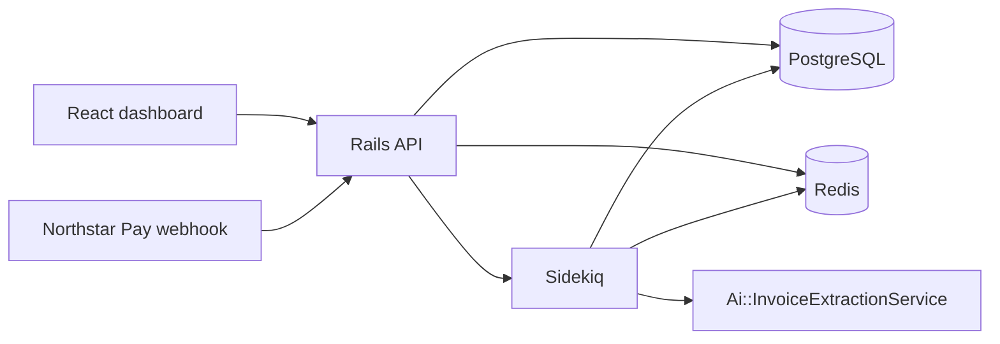

# FlowOps architecture

FlowOps is a multi-tenant invoice operations app. An account is a customer company. Customers, invoices, payment events, ledger entries, documents, and extraction runs all belong to an account.

## Runtime

The browser talks only to the JSON API. Demo authentication is the `Authorization: Bearer demo-account-{account_id}` header. It exists so local requests are deterministic. It is not an identity provider.

Northstar Pay calls `POST /api/webhooks/payments` with `X-Webhook-Token`. The token is `PAYMENTS_WEBHOOK_TOKEN`.

## Domain

| Model | Role |
| --- | --- |
| Account | Tenant |
| Customer | Buyer inside a tenant. `external_crm_id` is the CRM reference |
| Invoice | Amount in cents. Status is `pending`, `processing`, `processed`, or `failed` |
| PaymentEvent | Stored provider event. Provider name for the exercise is `northstar_pay` |
| LedgerEntry | Financial application of a successful payment. `payment_applied` records the invoice amount once the payment is accepted |
| Document | File metadata plus optional `extracted_data` |
| ExtractionRun | One recorded attempt to extract a document |

Invoice numbers are unique per account. Amounts are integers in cents.

## Request flow

Controllers stay thin and delegate to `Invoices::Query`, `Dashboard::Summary`, `Payments::ApplyWebhook`, and `Ai::InvoiceExtractionService`.

`GET /api/invoices` is paginated (`page`, `per_page`, optional `status` and `customer_id`). The list payload includes the customer name, amount, and status. `GET /api/invoices/:id` adds documents and `applied_cents`, the sum of ledger entries for that invoice.

`POST /api/documents/:id/process` enqueues `DocumentProcessingJob`. The worker calls the extraction service and stores an `ExtractionRun`.

## AI adapter

`Ai::ProviderRegistry` selects the provider:

- `AI_PROVIDER=mock` (default) uses `Ai::MockProvider`
- `AI_PROVIDER=openai` uses `Ai::OpenaiCompatibleProvider`, which speaks the chat-completions JSON API

The mock provider does not make a network call. For a normal filename it returns `invoice_number`, `amount_cents`, `currency`, and `vendor_name`. Filenames that contain one of these tokens simulate a provider outcome:

- `scenario-timeout`
- `scenario-rate-limit`
- `scenario-unavailable`
- `scenario-invalid`

Typed errors live under `Ai::Error`. `Ai::RetryableError` covers timeout, rate limit, and temporary unavailability. `Ai::InvalidResponseError` and `Ai::ConfigurationError` are not retryable. `AI_TIMEOUT_SECONDS` is the configured timeout budget.

The service must keep working when `OPENAI_API_KEY` is empty.

## Background processing

Sidekiq uses the `default` queue and Redis. `DocumentProcessingJob` is configured with `retry: 5`.

## Local data

`db/seeds.rb` resets the development database and inserts 300 invoices across three accounts, plus customers, payment events, ledger entries, and documents. The sequence is fixed, so a reseed reproduces the same ids.
